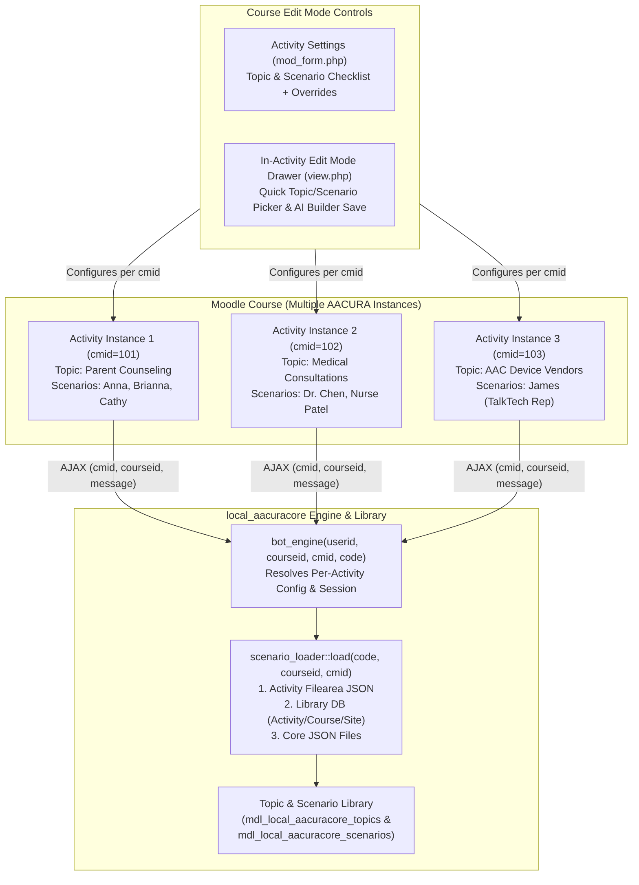

# Product Requirements Document (PRD)
## Major Version Upgrade: Per-Activity Configuration, Multi-Instance Isolation & Topic/Scenario Library
### Target Release: AACURA v2.0.0 (`local_aacuracore` 3.0.0 / `mod_aacurachat` 2.0.0)

---

## 1. Introduction & Executive Summary

### 1.1. Background & Problem Statement
In AACURA v1.x / v2.4.x, chatbot configuration, persona availability, and session resolution are tightly coupled to **site-wide global settings** (`local_aacuracore`) or **course-level lookups** (`courseid`) rather than **individual activity instances** (`cmid` / `mod_aacurachat` instance ID):

1. **Course-Level Instance Collisions (`courseid` vs. `cmid`)**:
   - `mod/aacurachat/view.php` initializes the frontend AMD module (`local_aacuracore/chat::init`) with `$COURSE->id` only, omitting `$cm->id`.
   - External web services (`local_aacuracore_chat_3`, `local_aacuracore_chat_4`, `local_aacuracore_history_3`, `local_aacuracore_history_4`), `local_aacuracore\api`, and `local_aacuracore\bot_engine::resolve_activity_settings()` query `$DB->get_record('aacurachat', ['course' => $courseid])`.
   - If a course contains **multiple `mod_aacurachat` activities** covering different clinical topics, Moodle either returns only the first activity record or throws a `dml_multiple_records_exception`, making multi-instance courses impossible.
2. **Global Persona Dropdown & Scenario Loading**:
   - Every `mod_aacurachat` activity renders the same global persona list from `get_config('local_aacuracore', 'active_scenarios')` and the flat `local_aacuracore_custom_scenarios` table.
   - Activity-specific `.json` files uploaded via the `mod_form.php` filepicker (`scenariofile` filearea) are never resolved by `scenario_loader::load()`.
3. **Absence of a Topic & Scenario Library**:
   - Scenarios exist as a flat, uncategorized list. Course administrators cannot organize scenarios by pedagogical **Topic** (e.g., *Early Intervention Parent Counseling*, *School-Based Peer Inclusion*, *Physician Consultations*, *SGD Vendor Evaluation*, *AAC User Self-Advocacy*) or curate a specific Topic and Scenario list for each activity instance in Course Edit Mode.
4. **Gradebook & Session Ambiguity**:
   - `aacurachat_update_grades()` in `mod/aacurachat/lib.php` looks up sessions by `['userid' => $userid, 'scenariocode' => $aacurachat->scenariocode]` instead of `cmid`, causing grade cross-talk when two activities share a scenario code.

### 1.2. Objectives
* **Per-Activity Architecture (`cmid`-First)**: Move all scenario loading, dialogue configuration, session tracking, and gradebook synchronization from global/per-course scope to **per-activity instance (`cmid`)** scope.
* **Multiple AACURA Instances per Course**: Enable any Moodle course to host unlimited `mod_aacurachat` activity instances, each configured with its own Topic, curated Scenario list, default persona, and simulation parameters.
* **Topic & Scenario Library**: Introduce a structured **Topic & Scenario Library** supporting built-in, course-level, and custom/AI-generated scenarios organized by clinical topic.
* **Course Edit Mode Topic & Scenario Selector**: Allow course administrators and instructors (`mod/aacurachat:addinstance` / `local/aacuracore:manage`) to select the Topic and Scenario list for each activity instance both in the **Activity Settings Form (`mod_form.php`)** and directly via an **In-Activity Edit Mode Configuration Drawer** when Course Edit Mode is active.
* **Universal LAFF "Don't Cry" Anchor**: Preserve the **LAFF "Don't Cry"** communication framework as the universal pedagogical foundation across all topics and roles.
* **Major Version Upgrade**: Execute a synchronized major version bump across `local_aacuracore` and `mod_aacurachat` with automated database migrations and full backward compatibility for existing courses.

---

## 2. Current Architecture (As-Is) vs. Target Architecture (To-Be)

### 2.1. Architectural Comparison

| Dimension | Current Architecture (v1.x / 2.4.x) | Target Architecture (Major Release v2.0 / 3.0) |
| :--- | :--- | :--- |
| **Instance Resolution** | Looked up by `courseid` (`$DB->get_record('aacurachat', ['course' => $courseid])`) | Strictly resolved by **`cmid`** (`get_coursemodule_from_id('aacurachat', $cmid)`) |
| **Instances per Course** | Effectively limited to 1 per course (collides if >1) | Unlimited independent `mod_aacurachat` instances per course |
| **Scenario Organization** | Flat list (4 hardcoded + `local_aacuracore_custom_scenarios`) | Hierarchical **Topic & Scenario Library** (`topics` → `scenarios`) |
| **Scenario Selection** | Global site setting (`local_aacuracore/active_scenarios`) | **Per-Activity** Topic & Scenario multi-select in Course Edit Mode |
| **Activity Filepicker JSON** | Saved to `mod_aacurachat` draft area but ignored by `scenario_loader` | Parsed, validated, and registered to the activity/library; loaded first by `scenario_loader::load($code, $courseid, $cmid)` |
| **Chat Persona Dropdown** | Displays all globally active scenarios in every activity | Displays **only** the scenarios enabled for that specific activity instance (or locks to single scenario if configured) |
| **Simulation Settings** | Global prompt template, generation profile; `min_turns` / `parent_intensity` looked up by `courseid` | Resolved per-activity (`cmid` → Scenario JSON → Topic default → Site fallback) |
| **Session & Gradebook Key** | Keyed loosely by `(userid, courseid, cmid=0)` or `(userid, scenariocode)` | Strictly keyed and indexed by **`(userid, cmid, scenariocode)`** |

### 2.2. Target Component & Data Flow Diagram



---

## 3. Functional Requirements

### 3.1. Topic & Scenario Library (`local_aacuracore`)
* **FR-1 (Topic Taxonomy):** The system must provide a structured **Topic Library** where each Topic groups related scenarios under a shared pedagogical theme (e.g., *Early Intervention & Parent Counseling*, *School-Based AAC & Peer Inclusion*, *Interprofessional Medical Consultations*, *AAC Device & Vendor Evaluation*, *AAC User Self-Advocacy & Autonomy*).
* **FR-2 (Topic Metadata):** Each Topic record must store:
  - `topiccode` (unique slug, e.g., `parent_counseling`, `medical_consult`)
  - `title` (human-readable name)
  - `description` (pedagogical summary and learning focus)
  - `default_role_type` (optional default persona role type, e.g., `parent`, `doctor`, `manufacturer_rep`, `aac_user`)
  - `default_min_turns` and `default_intensity` (optional topic-level defaults)
  - `scope` (`system` for site-wide topics, `course` for course-specific topics) and `courseid` (0 for system)
  - `visible` (boolean) and `sortorder` (integer)
* **FR-3 (Unified Single-Topic Scenario Library & Course-Scope Default):**
  - All scenarios (preloaded system scenarios, instructor-uploaded JSON scenarios, and AI Scenario Builder outputs) must be cataloged in the **Scenario Library**.
  - Each scenario belongs to a **single Topic** (`topicid` / `topiccode` 1-to-many relationship).
  - Scenarios created or uploaded by a course instructor default to **Course Scope** (`scope = 'course'`, `courseid = $COURSE->id`), making them visible only to activities within that course.
  - **Site Administrators** (`moodle/site:config` capability) can **promote** any course-scoped scenario (or course-scoped topic) to **System Scope** (`scope = 'system'`, `courseid = 0`) so it becomes available across all courses site-wide.
* **FR-4 (Pre-Seeded Default Topics & Scenarios):** Upon installation or upgrade, the library must automatically seed default Topics and link existing preloaded scenarios (`anna`, `brianna`, `cathy`, `mary` under **Topic: Parent & Family Counseling (LAFF)**) as well as migrate all existing records from `local_aacuracore_custom_scenarios` so zero custom content is lost.
* **FR-5 (Library Management UI & Site Admin Promotion):** Update `/local/aacuracore/scenario_builder.php` into the **AACURA Topic & Scenario Library Manager**, allowing authorized users (`local/aacuracore:manage`) to:
  - Create, edit, reorder, and archive Topics.
  - Assign each scenario to its single Topic when building a scenario via the form, uploading a `.json` file, or exporting/saving from the AI Scenario Builder.
  - Filter and preview scenarios by Topic, Role Type, and Scope (`System`, `Course`, `Activity`).
  - Provide a **"🌐 Promote to System Library"** action (visible to Site Administrators) on course-scoped scenarios and topics to elevate them to site-wide availability.

### 3.2. Choosing Topics & Scenarios in Course Edit Mode (`mod_aacurachat`)
* **FR-6 (Activity Settings Form — Topic & Scenario Selector in `mod_form.php`):**
  When a course administrator or editing teacher adds or edits an AACURA activity (`course/modedit.php`), the form must provide a **"Topic & Scenario Selection"** section containing:
  1. **Topic Selector (`topiccode`)**: Dropdown of all available System Topics + Course Topics for the current course, plus an *"All Topics / Custom Selection"* option.
  2. **Scenario List Multi-Select / Checklist (`scenariolist`)**: Interactive checklist of scenarios belonging to the selected Topic (dynamically filtered via AMD JS when the Topic dropdown changes, with progressive enhancement fallback if JS is disabled). Instructors check which scenarios are enabled for this activity instance.
  3. **Default Starting Scenario (`scenariocode`)**: Dropdown to pick which of the enabled scenarios loads first when a student opens the activity.
  4. **Allow Persona Switching (`allow_persona_switch`)**: Checkbox toggle (`1` = students can switch between the activity's enabled scenarios in the chat header dropdown; `0` = locks the student to the single default scenario and hides/disables the switcher).
  5. **Multi-Scenario Grading & Completion Mode (`grading_mode`)**: Dropdown allowing the instructor to choose how the activity is graded when multiple scenarios are enabled:
     - `single_highest` (*Complete any 1 scenario — Highest score*, default): Completing any enabled scenario posts a grade; if multiple are completed, the highest score is kept.
     - `single_latest` (*Complete any 1 scenario — Latest score*): The most recently completed scenario's score is recorded.
     - `all_average` (*Complete all enabled scenarios — Average score*): Students must complete every scenario in the activity's `scenariolist`; the Gradebook records the average score across all enabled scenarios.
  6. **Activity Custom Scenario Filepicker (`scenariofile`)**: Supports uploading custom `.json` scenario file(s) directly to the activity instance, with an optional checkbox *"Also register uploaded scenario(s) into the Course Topic Library"* (defaulting to `scope = 'course'`).
* **FR-7 (In-Activity Course Edit Mode Configuration Drawer in `view.php`):**
  When a user with `mod/aacurachat:addinstance` or `local/aacuracore:manage` views a `mod_aacurachat` activity while **Moodle Course Edit Mode is ON** (`$PAGE->user_is_editing()`):
  1. Display a **"📚 Topic & Scenario Library"** button in the chat header bar (next to **"🧠 Automated Scenario Builder"**).
  2. Clicking the button opens an inline configuration drawer/modal showing the current activity's selected Topic, checkboxes for all available scenarios in that Topic, the default scenario selector, and a **"Save to This Activity"** button.
  3. Saving updates the `aacurachat` instance record via AJAX (`local_aacuracore_update_activity_config`) and immediately refreshes the activity's persona dropdown without requiring navigation to `modedit.php`.
* **FR-8 (AI Scenario Builder Direct-to-Activity Registration):**
  When an instructor finishes creating a scenario in the **AI Scenario Builder** (in Course Edit Mode), alongside **"📥 Export Scenario JSON"**, provide a **"➕ Save to Activity & Topic Library"** button that registers the generated scenario into the chosen Topic and automatically enables it on the current `mod_aacurachat` activity instance.

### 3.3. Per-Activity Configuration & Runtime Isolation
* **FR-9 (Per-Activity Configuration Overrides):**
  Each `mod_aacurachat` activity instance must independently store and resolve its own configuration settings, overriding Topic and Site defaults:
  - `topiccode` (Selected Topic slug)
  - `scenariolist` (JSON/CSV array of enabled scenario codes for this instance)
  - `scenariocode` (Default initial scenario code for this instance)
  - `allow_persona_switch` (Boolean: whether students can switch personas within this instance's `scenariolist`)
  - `grading_mode` (`'single_highest'`, `'single_latest'`, or `'all_average'` — instructor-configurable grading policy across the activity's enabled `scenariolist`)
  - `min_turns` (Minimum student turns before rubric evaluation; `0` = inherit from Scenario/Topic/Site)
  - `parent_intensity` (Persona assertiveness level; `""` = inherit from Scenario/Topic/Site)
  - `generation_case` (LLM generation profile override: `""` = site default, `chatbot`, `creative`, `balanced`, `precise`, `exploration`, `formal`, `informal`)
  - `custom_prompt_template` (Optional per-activity persona system prompt override)
  - `custom_eval_template` (Optional per-activity rubric evaluation prompt override)
* **FR-10 (Configuration Resolution Hierarchy):**
  At runtime, `bot_engine` and `prompt_renderer` must resolve settings in strict priority order (highest to lowest):
  $$\text{1. Activity Instance Override } (\text{\texttt{cmid}}) \longrightarrow \text{2. Scenario JSON Definition} \longrightarrow \text{3. Topic Library Default} \longrightarrow \text{4. Site-Wide Default } (\text{\texttt{local\_aacuracore}})$$
* **FR-11 (Strict `cmid` Propagation Across Full Stack):**
  - `mod/aacurachat/view.php` must pass `$cm->id` to `local_aacuracore/chat::init($COURSE->id, $cm->id, release::version())`.
  - `local/aacuracore/amd/src/chat.js` must include `cmid` in all AJAX requests (`local_aacuracore_chat_3`/`_4` and `local_aacuracore_history_3`/`_4`).
  - `local_aacuracore\api::chat_api()` and `history_api()` must resolve the `aacurachat` record via `get_coursemodule_from_id('aacurachat', $cmid)` rather than `['course' => $courseid]`.
  - If a legacy caller omits `cmid` (`cmid = 0`), a safe fallback helper resolves the first visible `aacurachat` in `$courseid` so backward compatibility with existing tests is preserved.
* **FR-12 (Activity-Scoped `scenario_loader`):**
  `scenario_loader::load(string $scenarioid, int $courseid = 0, int $cmid = 0)` must resolve scenarios in the following order:
  1. **Activity Filearea (`mod_aacurachat` / `scenariofile`)** for `$cmid` (if `$scenarioid === 'custom'` or matches the uploaded JSON's `scenario_id`).
  2. **Scenario Library DB (`local_aacuracore_scenarios`)** matching `$scenarioid` (checking activity-scoped and course-scoped records for `$courseid` first, then system-scoped records where `scope = 'system'`).
  3. **Legacy Custom DB (`local_aacuracore_custom_scenarios`)** fallback during migration.
  4. **Physical JSON file** in `local/aacuracore/scenarios/{scenarioid}.json`.
  5. **Static PHP fallback profile**.
* **FR-13 (Activity-Scoped Persona Dropdown in `view.php`):**
  The persona selector dropdown in `mod/aacurachat/view.php` must **only** list scenarios included in the current activity instance's `scenariolist` (plus its uploaded `scenariofile` if configured). If `allow_persona_switch` is disabled or only 1 scenario is enabled, the dropdown renders as a clean static badge displaying the active persona and role label.
* **FR-14 (Per-Activity Session & Multi-Scenario Gradebook Calculation):**
  - `local_aacuracore_sessions` queries must filter by `['userid' => $userid, 'cmid' => $cmid, 'scenariocode' => $scenariocode]`.
  - `aacurachat_update_grades()` in `mod/aacurachat/lib.php` and `bot_engine::trigger_gradebook_sync()` must query `local_aacuracore_sessions` and `local_aacuracore_evaluations` by `cmid` and apply the activity's configured `grading_mode`:
    - `single_highest` (default): Posts the highest evaluation score achieved by the student across any scenario in the activity's `scenariolist`.
    - `single_latest`: Posts the most recent evaluation score achieved by the student in the activity.
    - `all_average`: Computes the average evaluation score across **all** $K$ scenarios enabled in `scenariolist` once the student has completed each enabled scenario.
* **FR-15 (Site Admin Settings Cleanup):**
  - Remove the global `local_aacuracore/active_scenarios` multiselect from `local/aacuracore/settings.php` (or convert it into a read-only summary + link to the Topic & Scenario Library Manager), clarifying that scenario activation is now managed per activity instance.
  - Retain AI provider credentials (Moodle Core AI, Google Gemini REST, OpenAI ChatGPT) and global fallback defaults in `local/aacuracore/settings.php`.

---

## 4. Database Schema & Technical Specifications

### 4.1. New & Updated Tables in `local/aacuracore/db/install.xml`

#### 4.1.1. New Table: `local_aacuracore_topics`
Stores topic categories for the Topic & Scenario Library.

| Column | Type | Null | Default | Description |
| :--- | :--- | :--- | :--- | :--- |
| `id` | `INT(10)` | No | Auto | Primary key |
| `topiccode` | `CHAR(100)` | No | — | Unique slug identifier (e.g., `parent_counseling`) |
| `title` | `CHAR(255)` | No | — | Display title of the topic |
| `description` | `TEXT` | Yes | `NULL` | Pedagogical overview & LAFF focus for this topic |
| `default_role_type` | `CHAR(50)` | Yes | `'parent'` | Default persona role type (`parent`, `doctor`, `manufacturer_rep`, `aac_user`, etc.) |
| `default_min_turns` | `INT(6)` | Yes | `8` | Default minimum student turns for scenarios in this topic |
| `default_intensity` | `CHAR(20)` | Yes | `'medium'` | Default persona intensity level |
| `scope` | `CHAR(20)` | No | `'system'` | `'system'` (global) or `'course'` (course-specific) |
| `courseid` | `INT(10)` | No | `0` | `0` for system topics, or Moodle `course.id` |
| `visible` | `INT(2)` | No | `1` | `1` = active/selectable, `0` = hidden |
| `sortorder` | `INT(10)` | No | `0` | Display ordering in dropdowns |
| `userid` | `INT(10)` | No | `0` | Author user ID |
| `timecreated` | `INT(10)` | No | `0` | Unix timestamp |
| `timemodified` | `INT(10)` | No | `0` | Unix timestamp |

* **Keys / Indexes**: Primary key on `id`; Unique index on `(topiccode, courseid)`; Index on `(scope, courseid, visible)`.

#### 4.1.2. Upgraded/New Table: `local_aacuracore_scenarios`
Unified library table storing both built-in and custom scenarios mapped to topics (superseding `local_aacuracore_custom_scenarios` while keeping `local_aacuracore_custom_scenarios` synced or aliased for backward compatibility).

| Column | Type | Null | Default | Description |
| :--- | :--- | :--- | :--- | :--- |
| `id` | `INT(10)` | No | Auto | Primary key |
| `scenariocode` | `CHAR(100)` | No | — | Scenario identifier (e.g., `anna`, `doctor_consult`) |
| `topicid` | `INT(10)` | No | `0` | Foreign key to `local_aacuracore_topics.id` |
| `topiccode` | `CHAR(100)` | No | `'parent_counseling'` | Denormalized topic slug for fast filtering and portable JSON export |
| `name` | `CHAR(255)` | No | — | Persona display name |
| `role_type` | `CHAR(50)` | No | `'parent'` | Role type (`parent`, `doctor`, `manufacturer_rep`, `aac_user`, etc.) |
| `role_label` | `CHAR(100)` | No | `'Parent Persona'` | Role display label |
| `description` | `TEXT` | Yes | `NULL` | Backstory summary / learning objective description |
| `json_data` | `TEXT` | No | — | Complete validated scenario JSON payload |
| `is_builtin` | `INT(2)` | No | `0` | `1` = shipped core scenario, `0` = custom/uploaded |
| `scope` | `CHAR(20)` | No | `'system'` | `'system'`, `'course'`, or `'activity'` |
| `courseid` | `INT(10)` | No | `0` | `0` for system-wide, or owning `course.id` |
| `cmid` | `INT(10)` | No | `0` | `0` for system/course, or owning `course_modules.id` |
| `visible` | `INT(2)` | No | `1` | `1` = enabled in library, `0` = archived |
| `sortorder` | `INT(10)` | No | `0` | Display order within topic |
| `userid` | `INT(10)` | No | `0` | Author user ID |
| `timecreated` | `INT(10)` | No | `0` | Unix timestamp |
| `timemodified` | `INT(10)` | No | `0` | Unix timestamp |

* **Keys / Indexes**: Primary key on `id`; Unique key on `(scenariocode, courseid, cmid)`; Foreign key `topicid` → `local_aacuracore_topics(id)`; Index on `(topiccode, visible)`.

#### 4.1.3. Index Addition on `local_aacuracore_sessions`
* Add composite index `userid_cmid_scenariocode_idx` on `(userid, cmid, scenariocode)` to ensure fast per-activity session lookups.

---

### 4.2. Expanded Activity Table in `mod/aacurachat/db/install.xml`

Update the `aacurachat` table to store per-activity topic, scenario list, and configuration overrides:

| Column | Type | Null | Default | Status | Description |
| :--- | :--- | :--- | :--- | :--- | :--- |
| `id` | `INT(10)` | No | Auto | Existing | Primary key |
| `course` | `INT(10)` | No | — | Existing | Foreign key to `course.id` |
| `name` | `CHAR(255)` | No | — | Existing | Activity instance name |
| `intro` | `TEXT` | Yes | `NULL` | Existing | Activity introduction / instructions |
| `introformat` | `INT(4)` | No | `0` | Existing | Intro format |
| `topiccode` | `CHAR(100)` | Yes | `'parent_counseling'` | **NEW** | Selected Topic code from the Topic Library |
| `scenariolist` | `TEXT` | Yes | `NULL` | **NEW** | JSON-encoded array (or comma-separated list) of scenario codes enabled for this activity instance |
| `scenariocode` | `CHAR(100)` | No | `'anna'` | Existing | Default starting scenario code for this activity |
| `allow_persona_switch` | `INT(2)` | No | `1` | **NEW** | `1` = allow students to switch between `scenariolist` personas; `0` = lock to `scenariocode` |
| `grading_mode` | `CHAR(30)` | No | `'single_highest'` | **NEW** | Multi-scenario grading policy: `'single_highest'`, `'single_latest'`, or `'all_average'` |
| `min_turns` | `INT(6)` | Yes | `0` | Existing | Per-activity minimum turns (`0` = inherit from Scenario/Topic/Site) |
| `parent_intensity` | `CHAR(20)` | Yes | `''` | Existing | Per-activity intensity override (`''` = inherit) |
| `generation_case` | `CHAR(30)` | Yes | `''` | **NEW** | Per-activity AI generation profile (`''` = site default, `chatbot`, `creative`, `balanced`, etc.) |
| `custom_prompt_template` | `TEXT` | Yes | `NULL` | **NEW** | Optional per-activity persona system prompt override |
| `custom_eval_template` | `TEXT` | Yes | `NULL` | **NEW** | Optional per-activity rubric evaluation prompt override |
| `timecreated` | `INT(10)` | No | `0` | Existing | Created timestamp |
| `timemodified` | `INT(10)` | No | `0` | Existing | Modified timestamp |

* **Backup & Restore Support (`mod/aacurachat/backup/moodle2/`)**:
  Update `backup_aacurachat_stepslib.php` and `restore_aacurachat_stepslib.php` to include `topiccode`, `scenariolist`, `allow_persona_switch`, `grading_mode`, `generation_case`, `custom_prompt_template`, `custom_eval_template`, and the `scenariofile` filearea so duplicating an activity or backing up/restoring a course preserves all per-activity configurations.

---

### 4.3. Pre-Seeded Default Topics & Scenarios

When `local_aacuracore` installs or upgrades to v3.0.0, `\local_aacuracore\library\topic_library_manager::seed_defaults()` populates the following starter Topic Library:

| Topic Code | Topic Title | Default Role | Seeded Scenarios |
| :--- | :--- | :--- | :--- |
| `parent_counseling` | **Parent & Family Counseling (Early Intervention & School)** | `parent` | `anna` (Anna Charles — Autism Pre-K), `brianna` (Brianna Mitchell — Apraxia/Peer Isolation), `cathy` (Cathy Fratner — Down Syndrome/App Skepticism), `mary` (Mary — System Consistency) |
| `medical_consult` | **Interprofessional Medical & Physician Consultations** | `doctor` | `doctor_consult` (Dr. Sarah Chen — Developmental Pediatrician) |
| `vendor_evaluation` | **AAC Device Selection & Manufacturer Representatives** | `manufacturer_rep` | `manufacturer_sales` (James Wilson — Regional AAC Specialist) |
| `self_advocacy` | **AAC User Self-Advocacy & Person-Centered Care** | `aac_user` | `aac_user_advocate` (Maya Johnson — Adult AAC Self-Advocate) |
| `iep_collaboration` | **School Administrator & IEP Team Collaboration** | `school_admin` | Extensible topic container for school team / administrator roleplays |

---

### 4.4. Scenario JSON Schema Addition (`topic` Field)

Scenario JSON files gain an optional top-level `"topic"` object or string so exported `.json` files self-declare their topic:

```json
{
  "scenario_id": "anna",
  "topic": {
    "code": "parent_counseling",
    "title": "Parent & Family Counseling (Early Intervention & School)"
  },
  "persona": {
    "name": "Anna Charles (Parent)",
    "role": {
      "type": "parent",
      "display_label": "Parent Persona"
    }
  }
}
```
* **Backward Compatibility**: If `"topic"` is omitted from an uploaded `.json` file, the Scenario Library assigns it to the topic selected in the upload form (defaulting to `parent_counseling`).

---

### 4.5. New & Modified Components Map

| Component / File | Plugin | Change Type | Responsibility |
| :--- | :--- | :--- | :--- |
| `local/aacuracore/db/install.xml` | `local_aacuracore` | Modified | Add `local_aacuracore_topics` and `local_aacuracore_scenarios` tables; add index on `local_aacuracore_sessions`. |
| `local/aacuracore/db/upgrade.php` | `local_aacuracore` | Modified | Create new tables, seed default topics & scenarios, and migrate existing `local_aacuracore_custom_scenarios` rows. |
| `local/aacuracore/classes/library/topic_library_manager.php` | `local_aacuracore` | **New** | CRUD service for Topics & Scenarios, activity scenario list resolution, and JSON import/export with topic metadata. |
| `local/aacuracore/classes/scenario/scenario_loader.php` | `local_aacuracore` | Modified | Update `load($scenarioid, $courseid, $cmid)` to load from activity filearea (`mod_aacurachat`/`scenariofile`) and `local_aacuracore_scenarios`. |
| `local/aacuracore/classes/bot_engine.php` | `local_aacuracore` | Modified | Resolve activity settings strictly by `$this->cmid` (with fallback to `courseid` only when `cmid === 0`); apply per-activity prompt/case overrides. |
| `local/aacuracore/classes/api.php` | `local_aacuracore` | Modified | Accept `$cmid` in `chat_api()` and `history_api()`; look up `aacurachat` instance via `$cmid`; add `update_activity_config()` for Edit Mode drawer. |
| `local/aacuracore/classes/external/chat_3.php` & `chat_4.php` | `local_aacuracore` | Modified | Add `cmid` (`VALUE_DEFAULT, 0`) parameter to `api_parameters()` and forward to `api::chat_api()`. |
| `local/aacuracore/classes/external/history_3.php` & `history_4.php` | `local_aacuracore` | Modified | Add `cmid` (`VALUE_DEFAULT, 0`) parameter to `api_parameters()` and forward to `api::history_api()`. |
| `local/aacuracore/classes/external/activity_library.php` | `local_aacuracore` | **New** | AJAX web service to fetch topics/scenarios and save per-activity topic & scenario selections in Course Edit Mode. |
| `local/aacuracore/amd/src/chat.js` | `local_aacuracore` | Modified | Accept `cmid` in `init(courseid, cmid, release)`, pass `cmid` on all AJAX calls, and wire the Edit Mode Topic & Scenario configuration drawer. |
| `local/aacuracore/scenario_builder.php` & `.html` | `local_aacuracore` | Modified | Upgrade into full Topic & Scenario Library Manager (create/filter topics, assign scenarios to topics). |
| `local/aacuracore/settings.php` | `local_aacuracore` | Modified | Replace global `active_scenarios` multiselect with Topic & Scenario Library Manager dashboard link. |
| `mod/aacurachat/db/install.xml` & `db/upgrade.php` | `mod_aacurachat` | Modified | Add `topiccode`, `scenariolist`, `allow_persona_switch`, `generation_case`, `custom_prompt_template`, `custom_eval_template` to `aacurachat`. |
| `mod/aacurachat/mod_form.php` | `mod_aacurachat` | Modified | Add Topic dropdown, dynamic Scenario checklist, allow-persona-switch toggle, and advanced per-activity AI overrides. |
| `mod/aacurachat/lib.php` | `mod_aacurachat` | Modified | Serialize `scenariolist` on save, parse uploaded `scenariofile` JSON into library if requested, and fix `aacurachat_update_grades()` to query by `cmid`. |
| `mod/aacurachat/view.php` | `mod_aacurachat` | Modified | Load only the current activity's `scenariolist`, pass `$cm->id` to JS `init()`, and pass Edit Mode topic/library context to `chat.mustache`. |
| `mod/aacurachat/templates/chat.mustache` | `mod_aacurachat` | Modified | Render Edit Mode **"📚 Topic & Scenario Library"** drawer and respect `allow_persona_switch`. |
| `mod/aacurachat/backup/moodle2/*` | `mod_aacurachat` | Modified | Backup and restore all new per-activity columns and `scenariofile` filearea. |

---

## 5. User Experience in Course Edit Mode

### 5.1. Workflow A: Configuring an Instance via Activity Settings (`mod_form.php`)
1. Course Admin turns **Edit Mode ON** in a Moodle course and clicks **Add an activity or resource → AACURA Chat** (or **Edit settings** on an existing instance).
2. Under **Topic & Scenario Library**:
   - Admin selects a **Topic** (e.g., `Parent & Family Counseling` for Activity 1, or `Interprofessional Medical Consultations` for Activity 2).
   - The **Scenario List** checklist automatically updates to show the scenarios in that Topic. Admin checks the scenarios they want available in this activity instance (e.g., `Anna Charles` and `Brianna Mitchell`).
   - Admin selects the **Default Starting Scenario** (`Anna Charles`) and chooses whether students can switch between the checked scenarios (`Allow Persona Switching = Yes`).
3. Under **Per-Activity Simulation & AI Settings**:
   - Admin optionally overrides `Minimum Turn Count` (e.g., `10 turns`), `Persona Intensity` (e.g., `High`), `AI Generation Profile` (e.g., `Chatbot`), or custom prompt templates for this specific activity.
4. Admin clicks **Save and display**.

### 5.2. Workflow B: Quick Configuration via In-Activity Edit Mode Drawer (`view.php`)
1. While **Course Edit Mode is ON**, the Course Admin opens an `aacurachat` activity instance.
2. In the chat header bar, alongside **🧠 Automated Scenario Builder**, the admin clicks **📚 Topic & Scenarios**.
3. An inline drawer expands displaying:
   - **Active Topic Dropdown** (switching filters the scenario checkboxes immediately).
   - **Enabled Scenarios Checklist** (check/uncheck personas from the library for this activity).
   - **Default Persona Selector** & **Allow Student Persona Switching** toggle.
   - **Save to Activity** button.
4. Clicking **Save to Activity** persists the selection to `mdl_aacurachat` for the current `$cm->id` via AJAX and immediately updates the activity's persona dropdown.

---

## 6. User Stories

* **US-1 (Multiple Instances per Course):** As a **course administrator**, I want to place multiple AACURA activities in different sections/weeks of the same course (e.g., Week 2: *Early Intervention Parent Counseling*, Week 5: *Physician Consultations*, Week 8: *AAC Vendor Evaluations*), so students practice distinct clinical topics throughout the semester without sessions or grades colliding.
* **US-2 (Topic & Scenario Library Selection):** As an **instructor**, I want to browse a categorized library of Topics and Scenarios in Course Edit Mode and pick which Topic and subset of Scenarios belong to each activity instance.
* **US-3 (Locked vs. Multi-Persona Activities):** As an **instructor**, I want the option to either lock an activity instance to a single mandatory scenario (for a graded exam) or provide a curated list of 3–4 scenarios under a Topic for open student practice.
* **US-4 (Per-Activity AI & Rubric Tuning):** As an **instructor**, I want to configure minimum turns, persona assertiveness, and prompt templates per activity so an introductory activity can be gentle (6 turns, Low intensity) while a capstone activity in the same course is challenging (12 turns, High intensity).
* **US-5 (Seamless Duplication & Course Backup):** As a **course designer**, when I duplicate an AACURA activity or backup/restore a course for a new term, I want each activity's Topic, Scenario list, and overrides to be preserved automatically.

---

## 7. Phased Implementation Plan

| Phase | GitHub Issue | Title & Scope |
| :--- | :--- | :--- |
| **Phase 1** | [Issue #18](https://github.com/llslim/moodle-plugin-aacuracore/issues/18) | `feat(v2.0-phase1)`: Database Schema, Topic & Scenario Library Service, and Migration Scripts |
| **Phase 2** | [Issue #19](https://github.com/llslim/moodle-plugin-aacuracore/issues/19) | `feat(v2.0-phase2)`: Per-Activity (`cmid`) Engine, Scenario Loader, Web Services, and Multi-Scenario Gradebook Refactoring |
| **Phase 3** | [Issue #20](https://github.com/llslim/moodle-plugin-aacuracore/issues/20) | `feat(v2.0-phase3)`: Course Edit Mode Topic & Scenario Selection UI (`mod_form.php`, In-Activity Drawer & Library Manager) |
| **Phase 4** | [Issue #21](https://github.com/llslim/moodle-plugin-aacuracore/issues/21) | `feat(v2.0-phase4)`: Moodle2 Backup/Restore, Automated Multi-Instance Testing, and Major Version Release (`v2.0.0` / `3.0.0`) |

```
┌─────────────────────────────────────────────────────────────────────────────┐
│                    PHASED IMPLEMENTATION ROADMAP                            │
├─────────────────────────────────────────────────────────────────────────────┤
│  PHASE 1 (#18): Database Schema, Topic Library Service & Migration Scripts  │
│  ├── Create local_aacuracore_topics & local_aacuracore_scenarios tables     │
│  ├── Add topiccode, scenariolist, allow_persona_switch, grading_mode,       │
│  │   generation_case, and prompt override columns to mod_aacurachat         │
│  ├── Implement topic_library_manager with default Topic & Scenario seeding  │
│  └── Build db/upgrade.php & CLI migration script for zero-downtime upgrade  │
├─────────────────────────────────────────────────────────────────────────────┤
│  PHASE 2 (#19): Per-Activity (cmid) Engine, Loader & Web Services           │
│  ├── Update chat.js, chat_3/4, history_3/4, and api.php to pass/use cmid   │
│  ├── Refactor bot_engine::resolve_activity_settings() to load by cmid       │
│  ├── Update scenario_loader::load() to support cmid filearea & Library DB   │
│  └── Fix mod/aacurachat/lib.php gradebook sync to query sessions by cmid    │
├─────────────────────────────────────────────────────────────────────────────┤
│  PHASE 3 (#20): Course Edit Mode UI (mod_form.php, view.php & Library UI)   │
│  ├── Upgrade mod_form.php with Topic selector, dynamic Scenario checklist,  │
│  │   default persona picker, grading_mode, and per-activity AI overrides    │
│  ├── Add Edit Mode "📚 Topic & Scenarios" inline drawer in chat.mustache    │
│  ├── Upgrade scenario_builder.php into Topic & Scenario Library Manager     │
│  └── Wire AI Scenario Builder "Save to Activity & Topic Library" action     │
├─────────────────────────────────────────────────────────────────────────────┤
│  PHASE 4 (#21): Backup/Restore, Automated Testing & Major Version Release   │
│  ├── Update Moodle2 backup/restore steps in mod_aacurachat                  │
│  ├── Add PHPUnit test suites for multi-instance courses & topic library     │
│  ├── Verify scenario crawler (aacuradebug_scenario.php) across all topics   │
│  └── Bump versions, tag v2.0.0-dev / v2.0.0, and update documentation       │
└─────────────────────────────────────────────────────────────────────────────┘
```

---

## 8. Release & Major Version Update Specification

In accordance with the **Git Branching & Semantic Versioning Policy** ([GEMINI.md Section 5](file:///d:/projects/windows/AAC-RERC%20Chatbot/GEMINI.md) and [.agents/AGENTS.md Rules 12 & 16](file:///d:/projects/windows/AAC-RERC%20Chatbot/.agents/AGENTS.md)), moving configuration and scenario loading from global/course scope to per-activity scope with a new Topic & Scenario Library constitutes a **Major Version Upgrade**.

### 8.0. Git Branching & Integration Workflow (`main` / `dev` / `dev-2.x` / `dev-3.x`)
To isolate 3.x architectural development from ongoing 2.x maintenance, the repositories use a 4-branch structure:
1. **`main` Branch**: Updated to match the current stable working 2.x version of `dev` prior to starting 3.x development.
2. **`dev-2.x` Branch**: Branched from the current 2.x baseline. Any bug fixes or hotfixes for the 2.x series are committed on `dev-2.x` and merged into `dev` and `main`.
3. **`dev-3.x` Branch**: Active feature development branch for all Phase 1–4 deliverables of this PRD (3.x series). All new 3.x features are developed on `dev-3.x` and merged into `dev` once integration-tested.
4. **`dev` Branch**: Integration and staging branch that receives completed merges from `dev-2.x` and `dev-3.x` before promoting releases to `main`.

```
main ◄──── (Production Release) ──── dev ◄──── (2.x Bug Fixes) ──── dev-2.x
                                      ▲
                                      └─────── (3.x Features) ───── dev-3.x
```

### 8.1. Version Number ↔ Release Number Mapping

| Component | Repository | Current `$plugin->version` | Target `$plugin->version` | Current `$plugin->release` | Target `$plugin->release` | Target Git Tag (`dev` → `main`) |
| :--- | :--- | :--- | :--- | :--- | :--- | :--- |
| **`local_aacuracore`** | `moodle-plugin-aacura_core_engine` | `2026100103` | `2026110100` | `2.4.21` | **`3.0.0`** | **`v2.0.0-dev`** → **`v2.0.0`** |
| **`mod_aacurachat`** | `moodle-activity-aacura_chat` | `2026100100` | `2026110100` | `1.2.0` | **`2.0.0`** | **`v2.0.0-dev`** → **`v2.0.0`** |

* **Cross-Plugin Dependency Update**:
  In `mod/aacurachat/version.php`, update `$plugin->dependencies` to require the new core engine version:
  ```php
  $plugin->dependencies = [
      "local_aacuracore" => 2026110100,
  ];
  ```

### 8.2. Automated Upgrade & CLI Migration Path
1. **Moodle Upgrade Hooks (`db/upgrade.php`)**:
   - `xmldb_local_aacuracore_upgrade($oldversion)` at version `2026110100`:
     - Creates `local_aacuracore_topics` and `local_aacuracore_scenarios`.
     - Seeds the 5 default Topics and built-in role scenarios.
     - Migrates all existing rows from `local_aacuracore_custom_scenarios` into `local_aacuracore_scenarios` under `parent_counseling` (or inferred role topic).
     - Backfills missing `cmid` values on existing `local_aacuracore_sessions` records by matching `courseid` to the course's existing `aacurachat` course module.
   - `xmldb_aacurachat_upgrade($oldversion)` at version `2026110100`:
     - Adds `topiccode`, `scenariolist`, `allow_persona_switch`, `grading_mode`, `generation_case`, `custom_prompt_template`, and `custom_eval_template` to `mdl_aacurachat`.
     - Populates `scenariolist` on existing activity instances using the site's previously enabled scenarios so existing courses experience zero behavioral disruption.
2. **CLI Migration Utility (`local/aacuracore/cli/migrate_to_per_activity.php`)**:
   - Standalone idempotent CLI script for site administrators to verify schema migrations, backfill `cmid` on historical sessions, and audit per-activity topic/scenario assignments.

---

## 9. Acceptance Criteria

* **AC-1 (Multi-Instance Course Isolation):** A single Moodle course with two or more `mod_aacurachat` instances (e.g., Instance A with Topic *Parent Counseling* and Instance B with Topic *Medical Consultations*) loads each instance's distinct persona dropdown, maintains separate chat histories (`local_aacuracore_sessions` keyed by `cmid`), applies separate `min_turns` / `parent_intensity` settings, and records grades to separate Gradebook columns without error.
* **AC-2 (Course Edit Mode Selection in `mod_form.php`):** Editing an `aacurachat` activity allows selecting a Topic, checking a subset of Scenarios from that Topic, setting the default starting scenario, toggling whether students can switch personas, and choosing the multi-scenario `grading_mode` (`single_highest`, `single_latest`, or `all_average`).
* **AC-3 (In-Activity Course Edit Mode Drawer):** Turning Course Edit Mode ON and opening an `aacurachat` activity displays the **"📚 Topic & Scenarios"** button for users with manage/editing capability, allowing instant AJAX updates to the activity's Topic and Scenario list.
* **AC-4 (Activity Filepicker Resolution):** Uploading a custom `.json` scenario file in `mod_form.php` makes that scenario immediately loadable by `scenario_loader::load($code, $courseid, $cmid)` for that activity instance.
* **AC-5 (Backward Compatibility & Migration):** Upgrading an existing Moodle site from v1.x / 2.4.x to v2.0.0 / 3.0.0 automatically migrates all `local_aacuracore_custom_scenarios` records into the new Topic & Scenario Library and preserves existing activity sessions and grades.
* **AC-6 (Universal LAFF Compliance):** Every seeded Topic and Scenario in the library enforces the universal **LAFF "Don't Cry"** evaluation framework.
* **AC-7 (Automated Tests & Crawler):** All PHPUnit tests (`local_aacuracore\scenarios_test`, `gradebook_test`, and new `per_activity_library_test`) and `php local/aacuracore/cli/aacuradebug_scenario.php --all` pass with zero errors.
* **AC-8 (Course Scope Default & Site Admin Promotion):** Scenarios created or uploaded by a course instructor default to `scope = 'course'` (`courseid = $course->id`) so they are isolated to that course, and Site Administrators (`moodle/site:config`) can promote them to `scope = 'system'` (`courseid = 0`) in the Topic & Scenario Library Manager.
* **AC-9 (Configurable Multi-Scenario Grading):** Activities configured with `grading_mode = 'single_highest'` record the student's highest score from any enabled scenario, while activities configured with `grading_mode = 'all_average'` compute the average score across all enabled scenarios in the activity's `scenariolist`.

---

## 10. Resolved Architectural Decisions

1. **Instructor-Created Scenario Visibility (`scope = 'course'` Promotable by Site Admin):**
   - Scenarios created or uploaded by course instructors default to **Course Scope** (`scope = 'course'`, `courseid = $COURSE->id`), keeping course-specific personas isolated to the course where they were authored.
   - Users with `moodle/site:config` (Site Administrators) have a **"🌐 Promote to System Library"** action in the Topic & Scenario Library Manager (`local/aacuracore/scenario_builder.php`) to promote vetted course scenarios/topics to **System Scope** (`scope = 'system'`, `courseid = 0`).
2. **Single Topic Assignment per Scenario (1-to-Many):**
   - Each scenario belongs to a **single Topic** via `topicid` and `topiccode` directly on `local_aacuracore_scenarios`, avoiding unnecessary join-table complexity and keeping `.json` scenario exports self-contained.
3. **Instructor-Configurable Multi-Scenario Grading (`grading_mode` in Activity Settings):**
   - Each `mod_aacurachat` activity instance exposes a `grading_mode` setting in `mod_form.php`, allowing the instructor to choose between:
     - `single_highest` (*Complete any 1 scenario — Highest score*, default)
     - `single_latest` (*Complete any 1 scenario — Latest score*)
     - `all_average` (*Complete all enabled scenarios in the activity list — Average score*)
